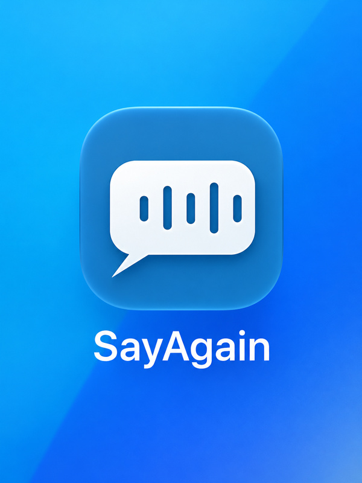

# SayAgain



SayAgain is a local-first assistive communication app for people who know what they want to express but may have difficulty finding or producing the word. It combines clues the person chooses to give—short speech, text, or an intentional photo—to offer possible words. The person confirms the meaning and chooses any phrase before the app speaks.

> The person chooses the meaning.

## Targets

- iPhone and iPad app: iOS/iPadOS 26 or later, Swift 6, SwiftUI, strict concurrency checking.
- Swift Student Challenge package: `SayAgainChallenge.swiftpm`, local and offline. Check the current Challenge submission rules and accepted package format before submission.
- English is the only configured speech locale in this MVP.

## Build

Open `SayAgain.xcodeproj` in Xcode 26 or later and run the **SayAgain** scheme on an iOS 26 simulator or device. The Student Challenge app playground is `SayAgainChallenge.swiftpm`. Its manifest declares an iOS application when built through Xcode’s AppleProductTypes; command-line SwiftPM uses a separate executable fallback for core tests. The package source and core/demo compile and test through SwiftPM, and the shared demo is UI-tested inside the full iOS app. The standalone `.swiftpm` app product has not been opened/launched through Xcode’s app-playground UI or Swift Playgrounds in this environment; validate that manually before submission.

Core candidate ranking, phrase templates, Quick Needs, personal vocabulary, and the Challenge fixture do not require a network connection. Speech recognition may require an Apple-managed English speech asset. SayAgain offers that installation only after the user chooses the speech flow. Foundation Models reranking is optional and falls back to deterministic ranking.

Run package tests from the package directory:

```sh
cd SayAgainChallenge.swiftpm
swift test
```

Run app unit and UI tests with the shared **SayAgain** scheme (Product → Test), or:

```sh
xcodebuild -project SayAgain.xcodeproj -scheme SayAgain \
  -destination 'platform=iOS Simulator,name=iPhone 17 Pro' test
```

The UI tests use an isolated in-memory database and a separate preferences suite. They do not reset normal app data.

## Implemented flows

- First-run onboarding with no capture permission prompts.
- Help Me Say It, live speech transcript, review/edit/retry, typed-clue fallback, and controls to edit or remove a clue after it changes suggestions.
- Say Typed Message for a complete message written in the person’s own words, with a review step before speech output.
- Deterministic candidate retrieval, context selection, Something Else search, and optional Foundation Models reranking.
- Intentional photo clues with local Vision classification and a typed-clue alternative.
- Quick Needs, a structured pain flow, phrase selection, and explicit AVSpeechSynthesizer output.
- Personal Words, personal phrases, user-created contexts, optional confirmed-choice learning, optional recent phrase history, and local settings.
- A clearly labeled Breakfast demo and optional Sarah fixture shared by the app and Challenge package. The standalone package contains this focused demo rather than the full application.
- Stable suggestion rows with explicit Update Suggestions for optional reranking; learning and history commit only after playback begins, with Replay deduplication.
- Live capture and demo speech share the same speech-output driver and serialized audio-session owner. Capture stop requests are scoped to their session, and a corrected spoken choice replaces only that flow’s own learning/history writes.
- Speech output creates AVSpeechSynthesizer only when Speak is first requested. A shared playback state and persistent primary button keep Speak/Stop/Replay in one stable position across preparation and playback.
- Prepared vocabulary reuses normalized aliases between clue changes; usage and confirmed mappings are indexed once per candidate request. The listening meter limits visual updates to 30 Hz while processing every audio buffer.
- Personal Words and existing settings migrate through SwiftData schema v2, which adds local built-in vocabulary recency without storing transcripts or media.
- The iPad app is configured for a single scene in v1 while retaining iPad layouts and device rotation.

## Product and safety boundary

SayAgain is assistive communication software. It does not know a person's thoughts, diagnose aphasia or stroke, provide treatment, or replace medical care or a speech-language pathologist. Every communicated meaning is chosen by the person. See [SAFETY.md](SAFETY.md) and [PRIVACY.md](PRIVACY.md).

## Status

This is an implemented MVP scaffold, not a claim of publication readiness or clinical effectiveness. Build and test results, as well as device-only validation still outstanding, are recorded in [BUILD_STATUS.md](BUILD_STATUS.md).

## Offline demo

The source for the local demo is in `SayAgainChallenge.swiftpm`. A copy is included in `Submission/SayAgainChallenge.zip` for convenient download. The demo uses labeled example clues and the shared deterministic candidate-ranking engine; it is not a live microphone or photo-recognition demonstration.

## Project documentation

See [ARCHITECTURE.md](ARCHITECTURE.md), [MODEL_BEHAVIOR.md](MODEL_BEHAVIOR.md), [ACCESSIBILITY.md](ACCESSIBILITY.md), [PRIVACY.md](PRIVACY.md), and [SAFETY.md](SAFETY.md) for technical and product information. See [BUILD_STATUS.md](BUILD_STATUS.md) for automated test results and unverified hardware-dependent behavior.
